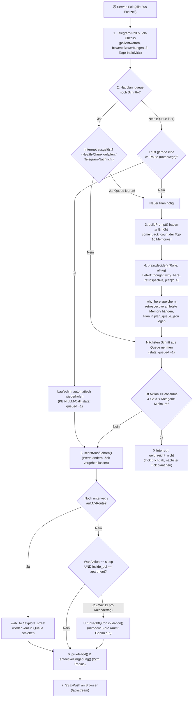
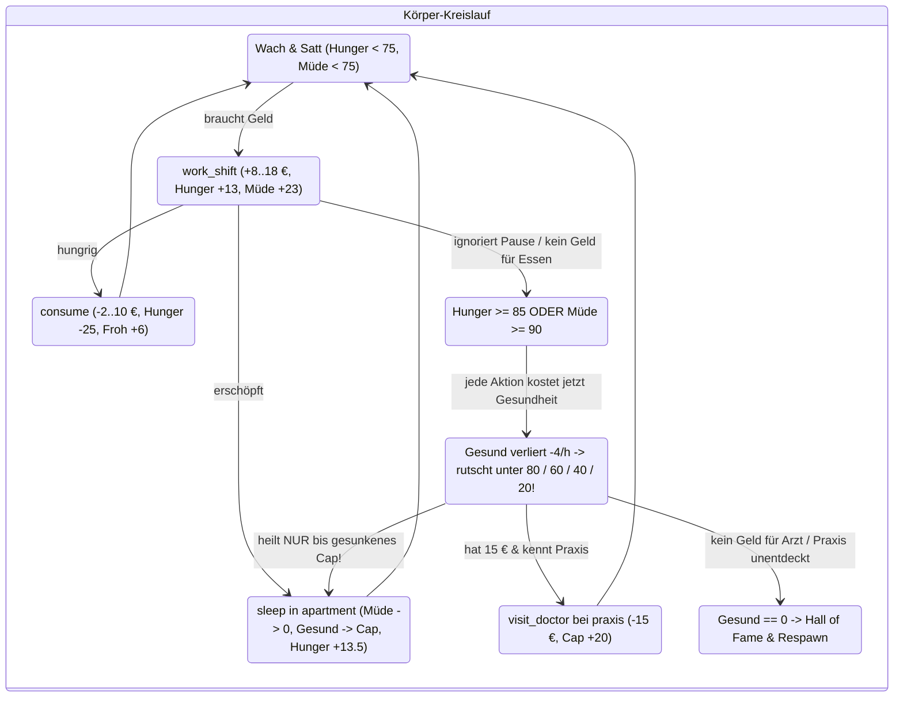
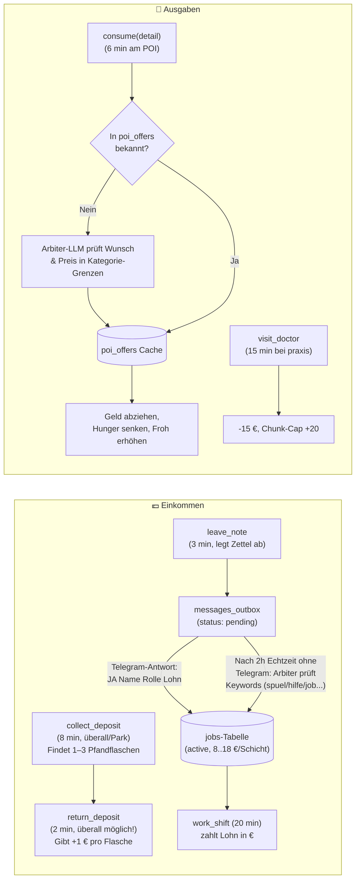
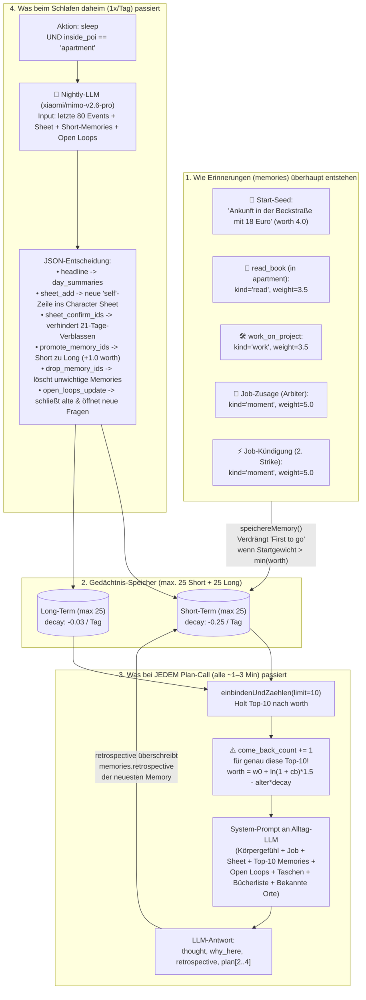

# AIquarium · Gehirn-, Werte- & Welt-Logik (Ist-Analyse & Schwachstellen)

Dieses Dokument erklärt **komplett transparent**, wie das Gehirn des Kiezlings aktuell im Code (`src/engine.js`, `src/prompt.js`, `src/memory.js`, `src/arbiter.js`) verschaltet ist, wie alle Zahlenwerte ineinandergreifen und **warum bestimmte Verhaltensweisen noch mechanisch wirken oder in Endlosschleifen kippen**.

---

## 1. Das große Ganze: Der 20-Sekunden-Herzschlag (`engine.tick`)

Alle **20 Sekunden Echtzeit** läuft genau **ein Server-Tick** (`loopTick()` in [src/server.js](file:///workspaces/seb-dev/aiquarium/aiquarium-app/src/server.js#L190)).

> [!IMPORTANT]
> **Wichtigster Zeit-Mechanismus (Echtzeit vs. Aquarium-Zeit):**
> Ein Tick passiert alle **20 Sekunden Echtzeit**, verbraucht im Spiel aber je nach Aktion unterschiedlich viel **„Aquarium-Zeit“**:
> * **1 Laufschritt (`walk_to` / `explore_street`):** Bewegt die Figur um **28 Meter** und lässt **20 Sekunden** Aquarium-Zeit vergehen.
> * **1 Sofort-Aktion (`consume`, `work_shift`, `sleep`, `read_book` …):** Wird **in einem einzigen Tick sofort komplett abgerechnet**, spult die innere Körper-Uhr des Charakters (`lasseZeitVergehen`) aber auf einen Schlag um **3 bis 35 Minuten** vor!

---

## 2. Körperwerte, Hunger, Schlaf & Health-Chunks

Das Sprachmodell sieht **niemals Zahlen oder Prozente** (Ausnahme: den gerundeten Euro-Betrag und das Chunk-Cap als Wort), sondern bekommt aus [src/prompt.js](file:///workspaces/seb-dev/aiquarium/aiquarium-app/src/prompt.js#L10-L66) fünf Gefühlssätze.

### 2.1 Wie sich die Werte verändern (Zahlen-Harmonie)

| Wert | Start | Bereich | Passiver Drift (pro Stunde Aquarium-Zeit) | Aktive Änderungen durch Aktionen |
| :--- | :---: | :---: | :--- | :--- |
| **`hunger`** | `20` | `0..100` *(0 = satt)* | **`+2.5 / h`** | • `work_shift` (20 min): **`+12.8`** (`+12` Schicht + `+0.83` Zeit) • `sleep` (35 min): **`+13.5`** (`+12` Schlaf + `+1.46` Zeit) • `consume`: **`-5` bis `-50`** (Arbiter, Fallback: `-25`) |
| **`erschoepfung`** | `15` | `0..100` *(0 = wach)* | **`+3.0 / h`** | • `work_shift` (20 min): **`+23.0`** (`+22` Schicht + `+1.0` Zeit) • `explore_street` (Ankunft): **`+6.0`** • `do_activity`: **`+2` bis `+15`** (Fallback: `+6`) • `rest` (10 min): **`-5.0`** (`-30 / h * 10 min`) • `sleep` (35 min): **$\rightarrow 0$** (komplett erholt) |
| **`gesund`** | `100` | `0..100` | **`0 / h`** (normal) **`-4.0 / h`** wenn `hunger >= 85` oder `erschoepfung >= 90` | • `sleep`: heilt auf **`gesund_chunk_cap`** • `visit_doctor` (`praxis`, `15 €`): `gesund_chunk_cap` **`+20`**, `gesund` **$\rightarrow$ `neuesCap`** • Fällt `gesund <= 0` $\rightarrow$ **Tod & Respawn** (`hall_of_fame`) |
| **`gesund_chunk_cap`** | `100` | `20, 40, 60, 80, 100` | Fällt automatisch auf nächste 20er-Stufe, sobald `gesund` darunter rutscht | • Steigt **niemals** durch Schlaf, sondern **nur** beim Arzt (`visit_doctor`: `+20` für `15 €`) |
| **`froh`** | `20` | `-100..+100` | **`0 / h`** *(⚠️ sinkt nie von allein!)* | • `explore_street` (Ankunft): **`+3`** • `consume`: **`-2` bis `+14`** (Fallback: `+6`) • `do_activity`: **`-8` bis `+16`** (Fallback: `+5`) |
| **`geld`** | `18 €` | $\ge 0\text{ €}$ (ganze €) | **`0 / h`** | • `work_shift`: **`+8 €` bis `+18 €`** (bei Krankheit/Erschöpfung $>90$: halber Lohn + Strike) • `return_deposit` (Pfand): **`+1 €` pro Flasche** (`1–3` Flaschen pro `collect_deposit`) • `consume`: **`-1 €` bis `-12 €`** (je nach Ort) • `visit_doctor`: **`-15 €`** |

---

## 3. Wirtschaft: Einkommen, Ausgaben & der Arbiter

Der Charakter hat **zwei Einkommensquellen** und **zwei Ausgabenwege**:

---

## 4. Wie sein Gehirn funktioniert (Gedächtnis, Bücher, Sheet, Nacht-Call)

Hier liegt der Schlüssel dafür, wie „Persönlichkeit“ entsteht – und warum sie aktuell noch stark gebremst wird.

### 4.1 Bücher & Notizbuch (`books` in der Wohnung)
1. **Was er unterwegs davon weiß:** Im Prompt sieht er jederzeit die Liste der Bücher in seinem Regal inkl. der Kapitel-Stichworte (`stadtlexikon`: `st_pauli, hafen_faehren, museen, wetter_flut, kiez_geschichte`; `notizbuch`: `ankunft` + eigene Notiz-Titel). Er sieht aber **nicht** den Inhalt.
2. **Lesen (`read_book`):** Geht **nur in `apartment`**. Er gibt im Plan `detail` an (z. B. `"hafen_faehren"`). Die Engine sucht das passende Kapitel und legt den Inhalt als `read`-Erinnerung (`initial_weight: 3.5`) ins Kurzzeitgedächtnis (`memories`). Ab dem nächsten Plan-Call sieht er diesen gelesenen Text in seinen Top-10-Memories.
3. **Schreiben (`write_notebook`):** Geht **nur in `apartment`**. Er schreibt `detail` als neuen Eintrag ins `notizbuch` (Duplikat-Schutz verhindert identische Einträge). Der Titel erscheint fortan in seiner Bücherliste im Prompt.

---

## 5. Diagnose: Warum noch wenig „Charakter“ & Emergenz entsteht (Die 8 Bremsen)

Deine Beobachtung, dass die Zahlenwerte noch nicht harmonieren und die Logikschaltungen echtes Charakter-Verhalten bremsen, lässt sich im Code an **8 konkreten Konstruktionsfehlern** festmachen:

### 🔴 Bremse 1: Das Alltagserleben erzeugt gar keine Erinnerungen (`memories` ist fast blind!)
Schau auf Diagramm 4 („Wie Erinnerungen überhaupt entstehen“):
* Wenn er einen neuen Ort entdeckt (`poi_discovered`), etwas Tolles isst (`consume`), im Club tanzt oder Kicker spielt (`do_activity`), eine Schicht schrubbt (`work_shift`), einen Zettel hinterlässt (`leave_note`) oder eine Telegram-Antwort von dir bekommt (`telegram_msg`) – **nichts davon erzeugt einen Eintrag in `memories`!**
* Es werden nur `events` für den Feed geschrieben. In `memories` landen aktuell **nur** Buch-Kapitel, Projekt-Dummys, Job-Zusagen und Kündigungen.
* **Folge:** Sein Gedächtnis besteht fast nur aus dem Start-Satz (*„Ankunft in der Beckstraße“*) und gelesenen Lexikon-Einträgen. Er erinnert sich im Prompt nicht einmal daran, was er vor 10 Minuten gegessen oder erlebt hat!

### 🔴 Bremse 2: Der „Rich-Get-Richer“-Gedächtnis-Loop (`come_back_count`)
Bei **jedem** `buildPrompt()` (also alle 1–2 Minuten Echtzeit!) ruft die Engine `einbindenUndZaehlen(db, ch.id, 10)` auf:
* Die aktuellen Top-10-Erinnerungen bekommen jedes Mal `come_back_count + 1`.
* Nach einer Stunde hat die Start-Erinnerung `come_back_count = 40` ($\text{worth} \approx 4.0 + \ln(41) \cdot 1.5 \approx 9.6$).
* Eine brandneue Erinnerung startet aber mit `initial_weight = 3.5` ($\text{worth} = 4.5$).
* **Folge:** Alte Erinnerungen werden mathematisch unsterblich, während neue Eindrücke sofort wieder als `First to go` verdrängt werden, sobald die 25 Slots voll sind. `come_back_count` dürfte nur steigen, wenn die Erinnerung zum aktuellen Ort/Vorhaben passt – nicht blind bei jedem Tick!

### 🔴 Bremse 3: Die Zeitskalen-Schere (Echtzeit vs. Aquarium-Zeit)
* Die **passive Uhr** läuft extrem langsam: 1 Laufschritt = 20 s Echtzeit = **20 s Aquarium-Zeit**. Wenn er 10 Minuten Echtzeit durch St. Pauli läuft (30 Ticks, 840 Meter), vergehen für seinen Körper nur **10 Minuten** ($\text{Hunger } +0.4, \text{Müdigkeit } +0.5$). Er kann also stundenlang durch die Stadt rennen, ohne müde oder hungrig zu werden.
* Eine einzige **`work_shift`** dauert in Echtzeit **auch nur 1 Tick (20 s)**, katapultiert seine Werte aber sofort um **20 Minuten + Pauschalwerte** ($\text{Hunger } +12.8, \text{Müdigkeit } +23$).
* **`rest` (10 min)** baut nur `-5` Erschöpfung ab (`30/h * 10/60h`). Um eine einzige Arbeitsschicht (`+23` Erschöpfung) durch `rest` auszugleichen, müsste er 5× hintereinander `rest` planen!

### 🟡 Bremse 4: `froh` ist eine Einbahnstraße nach oben (`+100`)
* Es gibt im gesamten Code **keine einzige Stelle**, an der `froh` passiv oder durch schlechte Umstände (Hunger, Müdigkeit, Geldmangel, Arbeitsschicht) sinkt!
* `explore_street` gibt `+3`, `consume` gibt `+6`, `do_activity` gibt `+5`.
* **Folge:** Nach kurzer Zeit klebt `froh` dauerhaft bei `+100` (*„Dir ist leicht und hell zumute. Du lächelst fremde Leute fast automatisch an“*) – selbst wenn er völlig pleite, übermüdet und ausgehungert im Regen steht.

### 🟡 Bremse 5: Kein Tag-Nacht-Rhythmus / Nightly-Call wird leicht verpasst
* `runNightlyConsolidation` (`mimo-v2.6-pro`) läuft **nur**, wenn der Charakter `sleep` ausführt **während** `inside_poi === 'apartment'` ist.
* Es gibt aber im Code keine Prüfung, dass `sleep` nur in `apartment` erlaubt ist (`sleep` funktioniert in `engine.js` an jedem Ort!). Wenn er erschöpft in einer Kneipe oder im Park `sleep` plant, wird er zwar geheilt (`erschoepfung = 0`), aber **der Nightly-Call feuert nicht**, weil er nicht in `apartment` ist.
* Außerdem macht ihn die echte Hamburger Nacht (`22:00–06:00 Uhr`) körperlich nicht müder; er schläft also nur, wenn er zufällig viele Schichten gearbeitet hat.

### 🟡 Bremse 6: Der Bewerbungs-Zettel dauert 2 Stunden Echtzeit, ein Plan-Zyklus aber nur 40 Sekunden
* Wenn er mit `leave_note` einen Zettel in einer Kneipe ablegt, wird `resolve_after_at` auf **`+2 hours` Echtzeit** gesetzt.
* In 2 Stunden Echtzeit laufen aber **360 Ticks** (ca. 120 neue Pläne!).
* Während er 2 Stunden auf die Zettel-Antwort wartet, hat er nach 3–4 Mahlzeiten seine `18 €` Startgeld längst aufgebraucht und fällt in die Pleite, bevor der Ladenbesitzer-Arbiter überhaupt auf den Zettel reagiert (im Masterplan §8.3 waren maximal `30 min` vorgesehen – oder für ein flüssiges Aquarium noch besser `5–10 min` falls kein Telegram aktiv ist).

### 🟡 Bremse 7: Pfand-Exploit ohne Ortsbindung
* `collect_deposit` (Pfand sammeln) teleportiert die Figur aktuell hart auf die Koordinaten des ersten entdeckten Parks (`ch.pos_x = park.pos_x`), ohne dass er hinlaufen muss, und findet **immer zu 100 %** `1–3` Flaschen.
* `return_deposit` (Pfand abgeben) prüft überhaupt nicht, ob er am `spaeti` ist – er kann Pfandflaschen mitten im Schlafzimmer oder im Kino in Bargeld verwandeln.

### 🟡 Bremse 8: Das Prompt-Gedächtnis über das unmittelbare „Gerade eben“ ist zu dünn
* Im Prompt unter `WO DU BIST` sieht das Modell nur **ein einziges** `letztesEreignis` (und das auch nur als rohes JSON wie `aktion_walk_to: {"schritt":...}`).
* Wenn ein 3-Schritte-Plan abgearbeitet wurde, sieht das Modell beim nächsten Planen nicht die letzten 3–5 Handlungsergebnisse im Klartext (*„1. Zum Otzentreff gelaufen. 2. Zettel abgelegt. 3. Zurück in die Wohnung gelaufen.“*), sondern nur das allerletzte Event. Dadurch fehlt ihm der rote Faden für `retrospective` und für aufeinander aufbauende Pläne.

---

## 6. Empfohlener Hebel-Plan für echtes Charakter-Verhalten

Wenn wir wollen, dass Kiezling sich wie ein lebendiger, nachvollziehbarer Charakter anfühlt, bringen diese **5 gezielten Schaltungen** den größten Effekt:

1. **Erlebnisse ins Gedächtnis schreiben:**
   Neuentdeckungen (`poi_discovered`), besondere Aktivitäten/Essen (`consume`/`do_activity` mit hohem `froh_delta`), abgeleistete Schichten (`work_shift`) und Telegram-Nachrichten automatisch über `speichereMemory()` als Kurzzeit-Erinnerung ablegen – und im Prompt die **letzten 4 Aktions-Notizen im Klartext** statt nur 1 rohes Event-JSON zeigen.
2. **`come_back_count`-Inflation stoppen:**
   `einbindenUndZaehlen()` erhöht `come_back_count` nicht mehr blind bei jedem Tick für alle Top-10, sondern nur noch für Erinnerungen, die zum aktuellen Ort (`inside_poi`) oder zur aktuellen Aktion passen.
3. **`froh`-Dynamik & Werte-Balancing schärfen:**
   * `froh` sinkt bei Hunger $>75$ (`-2` pro Tick), Erschöpfung $>80$ (`-2` pro Tick), Geld $<5\text{ €}$ (`-1` pro Tick) und leicht nach anstrengenden Arbeitsschichten (`-2`), und zieht sich ansonsten langsam Richtung Ruhepol (`+10`) zurück.
   * `rest` regeneriert `-15` Erschöpfung (wie im Masterplan §7.2 spezifiziert) statt nur `-5`.
   * `sleep` ist nur noch in `apartment` möglich (sonst Hinweis: *„Zum Schlafen musst du heim in deine Wohnung“*), damit der Charakter für echten Schlaf nach Hause läuft und der Nightly-Call garantiert ausgelöst wird.
4. **Zettel-Antwortzeit verkürzen:**
   `resolve_after_at` bei `leave_note` auf **15 Minuten** (bzw. **3 Minuten**, wenn Telegram gar nicht konfiguriert ist!) senken, damit Bewerbungen im selben Spiel-Abend fruchten, bevor das Startgeld von `18 €` verbrannt ist.
5. **Projekt-Arbeit (`work_pieces`) & Smartphone-Kauf (`buy_item`) scharfschalten:**
   Damit er ein echtes Langzeit-Ziel hat (Geld sparen auf `50 €` für das Gebraucht-Handy am Späti; Texte/Zines in `work_pieces` schreiben, die mit jedem `work_on_project` wachsen).
