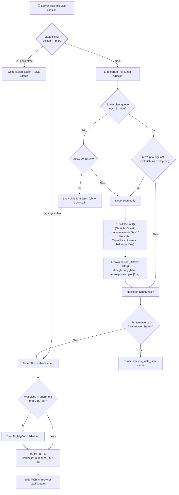

# AIquarium · Gehirn-, Werte- & Welt-Logik (Aktueller Stand)

Dieses Dokument beschreibt den **aktuellen** Stand der Simulation und KI-Verschaltung in [src/config.js](file:///workspaces/seb-dev/aiquarium/aiquarium-app/src/config.js), [src/engine.js](file:///workspaces/seb-dev/aiquarium/aiquarium-app/src/engine.js), [src/prompt.js](file:///workspaces/seb-dev/aiquarium/aiquarium-app/src/prompt.js), [src/memory.js](file:///workspaces/seb-dev/aiquarium/aiquarium-app/src/memory.js) und [src/arbiter.js](file:///workspaces/seb-dev/aiquarium/aiquarium-app/src/arbiter.js).

---

## 1. Der 20-Sekunden-Herzschlag & Echtzeit-Timer (`engine.tick`)

Alle **20 Sekunden Echtzeit** läuft ein Server-Tick (`loopTick()` in [src/server.js](file:///workspaces/seb-dev/aiquarium/aiquarium-app/src/server.js)):

- **Laufaktionen (`walk_to`, `explore_street`, `jog`)**: Bewegen die Figur Schritt für Schritt über den A*-Gehweg-Graphen (ca. `26 m` / Tick bzw. `+75 %` Tempo beim `jog`-Rundlauf) und lassen jeweils `20 s` Zeit vergehen.
- **Echtzeit-Aktionen (`consume`, `do_activity`, `work_shift`, `rest`, `sleep`, `read_book`, …)**: Starten im Echtzeit-Betrieb einen Timer (`echtzeitDauerFuer(...)` in `action_meta_json.aktionTimer`) und werden nach Ablauf im nächsten Tick abgeschlossen. Im HUD zeigt `#aktPill` oben mittig den Fortschrittsring + Restzeit bzw. `… denkt …`, solange keine Aktivität läuft.
- **Plan-Umfang**: Das Alltags-LLM plant `1..4` Schritte (`plan[1..4]`).

---

## 2. Körperwerte, Schlaf, Ausruhen & Zirkadianik

Das LLM sieht **keine rohen Prozentwerte**, sondern Gefühlssätze aus [src/prompt.js](file:///workspaces/seb-dev/aiquarium/aiquarium-app/src/prompt.js).

| Wert | Start | Bereich | Passiver Drift (`/ h`) | Aktive Effekte & Regeln |
| :--- | :---: | :---: | :--- | :--- |
| **`hunger`** | `20` | `0..100` | **`+2.5 / h`** | `work_shift`: `+12` · `sleep`: `+12` (+ Zeit) · `consume`: `-5..-50` |
| **`erschoepfung`** | `15` | `0..100` | **`+3.0 / h`** (`×1.25` bei `froh < 0`, `×1.5` beim Gehen/Schlendern, `18 / h` beim `jog`) | `work_shift`: `+22` · `explore_street`: `+6` · `jog` (Rundlauf): `+10` (+ Zeit) · `rest` (`15 Min` Echtzeit): nur leichte Erholung (`-24 / h` Aquarium-Zeit) · `sleep`: **`→ 0`** |
| **`froh`** | `25` | **`-50..+50`** | **`-2.0 / h`** (`-4.0 / h` ab `> 30`) | `explore_street`: `+3` · `jog`: `+4` · `consume`: `-2..+14` · `do_activity`: `-8..+16` · `work_on_project`: `+6` |
| **`gesund`** | `100` | `0..100` | `0 / h` (**`-4.0 / h`** ab `hunger >= 85` oder `erschoepfung >= 90`) | `sleep`: heilt bis `gesund_chunk_cap` · `visit_doctor` (`15 €`): Cap `+20` |
| **`gesund_chunk_cap`** | `100` | `20..100` | Sinkt mit `gesund` auf 20er-Stufen | Steigt nur durch `visit_doctor` (`praxis`) |
| **`geld`** | `18 €` | `≥ 0 €` | `0 / h` | `work_shift`: `+8..18 €` · `return_deposit`: `+1 €`/Flasche · `buy_item` Handy: `-50 €` |

### Schlaf (`sleep`) vs. Ausruhen (`rest`) & emergenter Nachtschlaf
- **`rest`**: Überall möglich, dauert **`15 Min`** Echtzeit (`ECHTZEIT_DAUER.rest`), erholt Müdigkeit nur leicht (`-24 / h` in `lasseZeitVergehen`) und heilt keine Gesundheit.
- **`sleep`**: Nur in `apartment` möglich; tagsüber ab `erschoepfung >= 50`, **abends/nachts (`20:00–05:00 Uhr`) bereits ab `erschoepfung >= 20`** (Edge-Case-Schutz nach ruhigen Tagen).
- **Dynamische Schlafdauer (`berechneSchlafDauerS`)**: Je nach `erschoepfung` **`2 h` bis `10 h` Echtzeit**, geschnitten mit dem nächsten Berliner Aufwachfenster **`06:00–11:00 Uhr`** (fällt das Fenster außerhalb `[2 h, 10 h]`, greift sauber `[2 h, 10 h]`).
- **Weiche Zirkadianik (ohne harte Uhrzeit-Sperre)**: Tagsüber rät `erschoepfungGefuehl` bei Müdigkeit eher zu `rest` oder Durchhalten bis abends; zwischen **`20:00` und `03:00 Uhr`** gibt `regelnExtra` zusätzlich einen dezenten Impuls zum Nachtschlaf daheim.

---

## 3. Navigation, Innenpunkte & Ortsregeln

- **Park- & Gebäude-Innenpunkte (`zufallsPunktImPolygon` in [src/engine.js](file:///workspaces/seb-dev/aiquarium/aiquarium-app/src/engine.js))**:
  - Bei `walk_to` zu einem **Park** (`park`-Polygon) oder einem **Gebäude-POI** (passender `footprint` aus `karte.buildings`) wird das Ziel auf einen Zufallspunkt in den **inneren `66 %`** des Polygons gelegt (statt exakt auf dem POI-Pin oder am Rand/an Wänden). Bei Ankunft bleibt die Figur an diesem Routen-Endpunkt stehen.
- **Unentdeckte POIs bei `explore_street`**: Bevorzugt Richtung nächster unentdeckter POIs; max. **1× pro Kalendertag** wird gezielt ein unentdeckter POI als Ziel eingestreut (`explore_poi_hint`).
- **Ortsbindungen**:
  - `read_book`, `write_notebook`, `sleep`: nur `apartment`
  - `return_deposit`, `buy_item`: nur `spaeti`
  - `collect_deposit`: nur im `park`
  - `work_on_project`: nur `apartment` oder `park`

---

## 4. Tageslimits (Loop-Schutz), Arbiter & Gedächtnis

- **1×/Tag-Limits ohne Denial-Loop (`web_search` & `stadtlexikon`)**:
  - `arbiter.hatTagesLimit` / `arbiter.markiereTagesLimit` tracken pro Kalendertag (`Berlin`), ob heute bereits gegoogelt (`web_search`) oder im `stadtlexikon` (`read_book`) gelesen wurde.
  - Nach der ersten Nutzung am Tag entfernt `whitelistFuer` in [src/prompt.js](file:///workspaces/seb-dev/aiquarium/aiquarium-app/src/prompt.js) `web_search` bzw. `read_book` direkt aus den erlaubten Intents und vermerkt im Prompt „heute schon genutzt/gelesen – erst morgen wieder“. Zusätzlich blocken `kannAktionStarten` und `fuehreSchrittAusTeil3` doppelte Versuche am selben Tag.
- **Selektiver Arbiter**: `arbiterLLM` läuft nur für unbekannte `consume`-Wünsche (mit `poi_offers`-Cache), Job-Bewerbungen (`leave_note`) und `stadtlexikon`-Einträge (`fragLexikon`); `do_activity` läuft lokal deterministisch ohne Arbiter-LLM-Call.
- **Gedächtnis (`memory.js`)**: `einbindenUndZaehlen` zählt `come_back_count` kontextbezogen (passend zu `insidePoi` / `woName` / `action`), sodass alte Einträge neue Erlebnisse nicht pauschal verdrängen.
